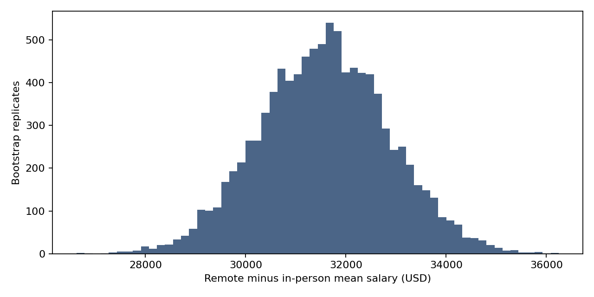
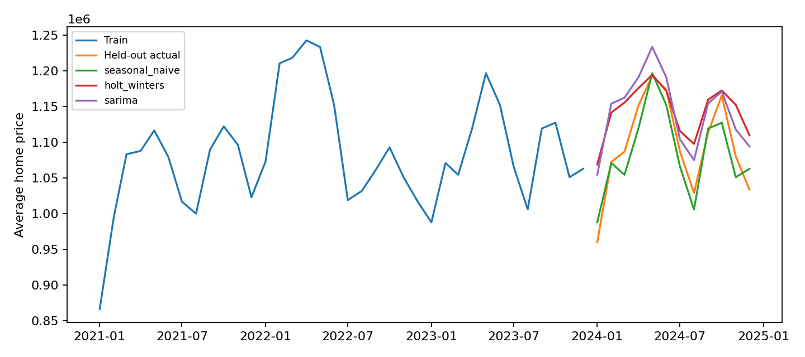

# MEng Data Science Portfolio

**Chelsea Rulangyue Zhao · University of Toronto**  
Master of Engineering, Chemical Engineering · Emphasis in Data Analytics and Machine Learning · Degree conferred October 2026

[](https://github.com/rulangyuezhao-cmd/meng-data-science-portfolio/actions/workflows/validate.yml)
[LinkedIn](https://www.linkedin.com/in/zhao-chelsea/) · [GitHub profile](https://github.com/rulangyuezhao-cmd) · [ReasonEval](https://github.com/rulangyuezhao-cmd/mie1512-reasoneval-portfolio)

This collection connects my graduate coursework to practical data science: preparing data, testing hypotheses, comparing models, interpreting results, and building repeatable analytical workflows.

**15 runnable CPU analyses across four technical courses**, plus the separate ReasonEval repository and summaries of my remaining completed MEng courses. The programs here are compact portfolio adaptations of recovered coursework, prepared with AI-assisted refactoring in November 2026. They document changes from the original submissions; they are not exact replays of every original notebook or model experiment.

## Start here

| Project | Question and methods | Explore |
| --- | --- | --- |
| **Salary statistics** | How do observed salary distributions differ by work arrangement and education? Welch tests, unequal-variance ANOVA, 10,000 bootstrap resamples. | [MIE1624](courses/mie1624/) |
| **Classification and clustering** | Predict salary categories and group skills using categorical pipelines, baseline comparisons, K-means and hierarchical clustering. | [MIE1624 notebook](notebooks/mie1624.ipynb) |
| **Foundations of machine learning** | Compare classifiers, detect anomalous satellite observations, reduce sales dimensions, and implement gradient descent. | [APS1070](courses/aps1070/) |
| **Process data analytics** | Demonstrate data quality checks, SQL summaries, interpretation, drift simulation, country comparisons, and Toronto housing forecasts. | [CHE1148](courses/che1148/) |
| **AI in finance** | Test seasonal models, yield-curve factors, FX forecasting baselines, and a trading workflow on fixed historical inputs. | [APS1052](courses/aps1052/) |
| **ReasonEval** | Evaluate mathematical reasoning in 3,400 solutions from 12 language models against human annotations. CPU analysis of saved inference results. | [Existing MIE1512 repository](https://github.com/rulangyuezhao-cmd/mie1512-reasoneval-portfolio) |

## Run the projects

Python **3.12** is the reference environment. No cloud account, API key, GPU, or private Drive mount is required for these 15 programs. Package installation requires internet access; the analyses use bundled inputs.

```bash
git clone https://github.com/rulangyuezhao-cmd/meng-data-science-portfolio.git
cd meng-data-science-portfolio
python -m venv .venv
```

Activate the environment in your shell:

```powershell
# Windows PowerShell
.\.venv\Scripts\Activate.ps1
```

```bash
# macOS / Linux
source .venv/bin/activate
```

Then install and run:

```bash
python -m pip install -r requirements.txt
python -m unittest discover -s tests -v
python run.py list
python run.py all
python tools/check_results.py
```

For a single example: `python run.py mie1624-salary-statistics`. Results, CSV tables, and figures appear in `generated/<project>/`. To explore interactively, open a [course notebook](notebooks/) in VS Code or Jupyter and select this Python environment. The command-line runner is the simplest way to reproduce everything.

## What the work demonstrates

| Capability | Evidence |
| --- | --- |
| Applied statistics | Welch tests, bootstrap confidence intervals, distribution checks, explicit limits on causal interpretation |
| Data wrangling | Typed CSV inputs, missing-value handling, restructuring time series, aggregate feature tables |
| Machine learning | Pipelines, validation splits, cross-validation, classifiers, regression, anomaly detection, clustering, PCA |
| SQL and processing workflows | SQLite customer-year aggregation, data manifests, repeatable commands, machine-readable result checks |
| Git and reproducibility | Versioned code and inputs, pinned analytical dependencies, GitHub Actions execution |
| Communication | Course context, scope notes, honest model comparisons and documented limitations |

My Azure experience comes from the CMTE industry project described in the [MEng project summary](courses/che1800/). These local programs do not demonstrate a deployed Azure service. The collection does not claim Property & Casualty insurance experience, randomized online A/B testing, or production geospatial/routing work.

## Example outputs

**Statistical uncertainty:** a bootstrap distribution of the remote-minus-in-person mean salary difference in the filtered survey sample. This is an observational comparison, not a causal estimate.



**Forecast evaluation:** model predictions are compared with held-out Toronto home prices and a seasonal naive baseline. The baseline is retained even when it wins.



Current numerical results are in [validation/metrics.json](validation/metrics.json); rerunning creates fresh outputs under `generated/`.

## Education and course coverage

I hold a **B.A.Sc. in Chemical Engineering** (University of Toronto, conferred June 2023), with minors in **Bioengineering** and **Engineering Business**, and a **Master of Engineering in Chemical Engineering** (conferred October 2026).

The [complete MEng course index](COURSE_COVERAGE.md) follows my academic history rather than the existence of a Drive folder. It includes all seven completed taught courses, the MEng project, and the safety workshop. Non-programming courses are represented by summaries. Dropped courses are excluded.

See [reproducibility and validation](REPRODUCIBILITY.md), [data provenance](DATA_SOURCES.md), and [third-party notices](THIRD_PARTY_NOTICES.md) for the exact boundaries of this portfolio.
